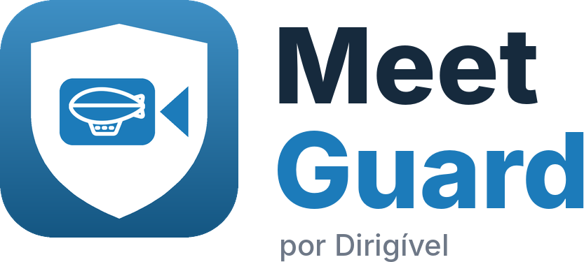

<p align="center">
  
</p>

<p align="center">
  Liga e desliga o <b>microfone</b> e a <b>câmera</b> do Windows com um atalho de teclado,<br>
  e mostra o estado de cada um em ícones ao lado do relógio.
</p>

---

## Recursos

- **Atalhos configuráveis** — por padrão `Ctrl + Alt + M` (microfone) e `Ctrl + Alt + C` (câmera).
- **Ícones na bandeja** — verde ligado, vermelho desligado; clique para alternar.
- **Desliga a câmera de verdade** — corta a imagem mesmo numa chamada já aberta (Meet, Jitsi, Teams, Zoom…).
- **Escolha das câmeras** — por exemplo, controla a webcam e deixa a câmera do celular de fora.
- **Janela de configurações** — controles, atalhos, câmeras, iniciar com o Windows e avisos.
- **Instalador em português** — com desinstalação que libera microfone e câmera.

## Instalação

Baixe o instalador mais recente em **[Releases](../../releases)** e execute.
O Meet Guard precisa de permissão de administrador para ligar e desligar a câmera.

## Como gerar o instalador

**Automático (GitHub):** cada push na `main` gera o instalador em *Actions → Instalador → Artifacts*.
Para publicar uma versão, atualize `VERSAO` em `marca.py` e crie uma tag:

```bash
git tag v1.0.0
git push origin v1.0.0
```

**No seu computador (Windows):** com o Python instalado, rode `construir_instalador.bat`.
O instalador aparece na pasta `instalador`.

## Personalização da marca

Nome, versão, contato e cor ficam em [`marca.py`](marca.py). O ícone vem de [`logo.png`](logo.png).
Depois de mudar, gere o instalador de novo. **Não altere `APP_GUID`.**

## Estrutura

| Arquivo | Função |
|---|---|
| `meetguard.py` | o programa (bandeja, atalhos, janela) |
| `marca.py` | identidade: nome, versão, cor, contato |
| `gerar_marca.py` | gera ícone e imagens do instalador |
| `MeetGuard.iss` | roteiro do instalador (Inno Setup) |
| `construir_instalador.bat` | gera tudo localmente |
| `.github/workflows/release.yml` | gera e publica pelo GitHub |

Configurações e registros do usuário ficam em `%APPDATA%\Dirigivel\MeetGuard`.

## Política de assinatura de código

Os instaladores publicados em Releases são compilados automaticamente pelo GitHub Actions a partir deste repositório.

Free code signing provided by [SignPath.io](https://about.signpath.io), certificate by [SignPath Foundation](https://signpath.org).

| Papel | Responsável |
|---|---|
| Autores e revisores | [Dirigível](https://github.com/dirigivel7) |
| Aprovação de assinatura | [Dirigível](https://github.com/dirigivel7) |

**Privacidade:** o Meet Guard não coleta nem envia nenhum dado. Ele não acessa a internet; só altera o estado do microfone e da câmera no próprio computador.

## Licença

[MIT](LICENSE) © Dirigível — [dirigivel.com.br](https://dirigivel.com.br) · contato@dirigivel.com.br
